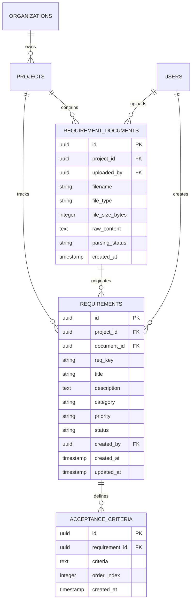

# Phase 4 Implementation Plan: Requirements Ingestion & Parsing Engine
> **Platform:** AI-Powered Software Testing & Bug Intelligence Platform  
> **Status:** PLAN ONLY — Do NOT implement yet.  
> **Architecture Pattern:** Repository → Service → Endpoint → Pydantic Schema (Backend) & Standalone Components → Services → Reactive State (Frontend)  
> **Target Release:** Phase 4 of 11  

---

## 1. Overview & Objectives

In modern QA engineering, test suites and test automation cannot exist without clear requirements. Phase 4 builds the **Requirements Ingestion & Parsing Engine**, enabling product managers, QA leads, and developers to bring software specifications into the platform.

### Core Capabilities to Deliver:
1. **Document Ingestion**:
   - Upload PRD and specification documents in `.md`, `.txt`, and `.pdf` formats (up to 10 MB).
   - Track document history, metadata, and ingestion status (`pending`, `parsed`, `failed`).
2. **Parsing Engine**:
   - Automatically extract sections, user stories (`As a... I want... So that...`), and acceptance criteria (`Given... When... Then...`).
   - Assign sequential project-scoped requirement keys (e.g., `AUTH-REQ-01`, `AUTH-REQ-02`).
3. **Manual Requirements Authoring**:
   - Full CRUD: Create, read, update, and deprecate requirements directly in the UI without file upload.
   - Add, edit, or reorder acceptance criteria dynamically.
4. **Multi-Tenant Traceability**:
   - Strict project-level and organization-level data isolation.
   - Requirements link directly to projects, laying the foundation for **Phase 5 (Test Cases)** and **Phase 9 (AI Test Case Generation)**.

---

## 2. Codebase Integration & Non-Regression Safeguards

All existing functionality from Phases 1, 2, and 3 must continue to function without any breaking changes.

### Existing Architecture Integration:
| Existing Component | Current Role | Phase 4 Integration (Zero Regression) |
| :--- | :--- | :--- |
| `app/core/database.py` | Engine, session maker, `Base` | New requirement models inherit from the same `Base`. |
| `app/core/security.py` | JWT auth & bcrypt | Unchanged. All requirement routes reuse standard token authentication. |
| `app/api/dependencies.py` | Role & tenant checks | Add `require_project_access` dependency to verify the user belongs to the project's organization. |
| `app/models/project.py` | Project tenant model | Add SQLAlchemy relationships to `Requirement` and `RequirementDocument`. |
| `app/models/user.py` | User entity model | Add relationships for `uploaded_documents` and `created_requirements`. |
| `app/api/v1/router.py` | Master API router | Mount `requirements.router` under `/projects/{project_id}/requirements`. |
| `migrations/` | Alembic database versions | Add `003_create_requirements_tables.py` without modifying prior migration files. |
| `frontend/layout/sidebar` | Shell navigation menu | Enable `Requirements` navigation link (`disabled: false`, remove `Soon` badge). |
| `frontend/app.routes.ts` | Angular routing | Register `/requirements` route guarded by `authGuard`. |

---

## 3. Database Schema Design

### Entity-Relationship Diagram:



### PostgreSQL DDL Specifications:

```sql
-- 1. Document Parsing Status Enum
CREATE TYPE doc_parsing_status AS ENUM ('pending', 'parsed', 'failed');

-- 2. Requirement Enums
CREATE TYPE req_category AS ENUM ('functional', 'non_functional', 'security', 'ui_ux', 'performance');
CREATE TYPE req_priority AS ENUM ('low', 'medium', 'high', 'critical');
CREATE TYPE req_status AS ENUM ('draft', 'approved', 'deprecated');

-- 3. Requirement Documents Table
CREATE TABLE requirement_documents (
    id UUID PRIMARY KEY DEFAULT gen_random_uuid(),
    project_id UUID NOT NULL REFERENCES projects(id) ON DELETE CASCADE,
    uploaded_by UUID REFERENCES users(id) ON DELETE SET NULL,
    filename VARCHAR(255) NOT NULL,
    file_type VARCHAR(20) NOT NULL,
    file_size_bytes INTEGER NOT NULL,
    raw_content TEXT,
    parsing_status doc_parsing_status NOT NULL DEFAULT 'pending',
    created_at TIMESTAMPTZ NOT NULL DEFAULT NOW()
);

-- 4. Requirements Table
CREATE TABLE requirements (
    id UUID PRIMARY KEY DEFAULT gen_random_uuid(),
    project_id UUID NOT NULL REFERENCES projects(id) ON DELETE CASCADE,
    document_id UUID REFERENCES requirement_documents(id) ON DELETE SET NULL,
    req_key VARCHAR(50) NOT NULL,
    title VARCHAR(255) NOT NULL,
    description TEXT,
    category req_category NOT NULL DEFAULT 'functional',
    priority req_priority NOT NULL DEFAULT 'medium',
    status req_status NOT NULL DEFAULT 'draft',
    created_by UUID REFERENCES users(id) ON DELETE SET NULL,
    created_at TIMESTAMPTZ NOT NULL DEFAULT NOW(),
    updated_at TIMESTAMPTZ NOT NULL DEFAULT NOW(),
    CONSTRAINT uq_project_req_key UNIQUE (project_id, req_key)
);

-- 5. Acceptance Criteria Table
CREATE TABLE acceptance_criteria (
    id UUID PRIMARY KEY DEFAULT gen_random_uuid(),
    requirement_id UUID NOT NULL REFERENCES requirements(id) ON DELETE CASCADE,
    criteria TEXT NOT NULL,
    order_index INTEGER NOT NULL DEFAULT 0,
    created_at TIMESTAMPTZ NOT NULL DEFAULT NOW()
);

-- 6. Indexes for Performance
CREATE INDEX ix_req_docs_project_id ON requirement_documents(project_id);
CREATE INDEX ix_requirements_project_id ON requirements(project_id);
CREATE INDEX ix_requirements_category ON requirements(category);
CREATE INDEX ix_requirements_priority ON requirements(priority);
CREATE INDEX ix_requirements_status ON requirements(status);
CREATE INDEX ix_acceptance_criteria_req_id ON acceptance_criteria(requirement_id);
```

---

## 4. Ingestion & Parsing Engine Architecture

### Supported Document Formats:
- **Markdown (`.md`)**: Analyzes heading levels (`#`, `##`, `###`), bullet lists, and code blocks.
- **Plain Text (`.txt`)**: Analyzes line breaks, indentation, and standard section headers (`Requirement:`, `Acceptance Criteria:`).
- **PDF (`.pdf`)**: Extracts plain text stream page-by-page using `pypdf`.

### Parsing Pipeline:

```mermaid
flowchart LR
    A[Raw File Upload] --> B[Validation Check: Size <= 10MB, Valid Ext]
    B --> C[Text Extraction: pypdf / utf-8 decode]
    C --> D[Save RequirementDocument with status=pending]
    D --> E[Heuristic Parser Engine]
    E --> F[Section & Story Splitter]
    F --> G[Extract Acceptance Criteria]
    G --> H[Generate Sequential Keys KEY-REQ-N]
    H --> I[Bulk Insert Requirements & Criteria]
    I --> J[Update Document status=parsed]
```


### Heuristic Extraction Rules:
1. **User Story Pattern Match**:
   `(?i)As an?\s+([^,\n]+)[,\s]+I want to\s+([^,\n]+)[,\s]+(so that\s+[^\n]+)?`
2. **Acceptance Criteria Pattern Match**:
   - Given/When/Then: `(?i)(Given\s+[^\n]+\s+When\s+[^\n]+\s+Then\s+[^\n]+)`
   - Bulleted checklist: `(?m)^\s*[-*•]\s+\[?[ xX]?\]?\s*(.+)`
   - Numbered items: `(?m)^\s*\d+[\.\)]\s+(.+)`
3. **Fallback Mode**:
   If unformatted text is provided, the parser groups text by major paragraphs/headers into individual requirement draft items with a generic acceptance check.

---

## 5. Backend Implementation Steps (Layer-by-Layer)

### Step 1: Dependencies & Models
- Update `backend/requirements.txt` to include `pypdf>=5.1.0`.
- Create `backend/app/models/requirement.py` containing:
  - `RequirementDocument`
  - `Requirement`
  - `AcceptanceCriteria`
  - Enums: `DocumentParsingStatus`, `RequirementCategory`, `RequirementPriority`, `RequirementStatus`
- Register models in `backend/app/models/__init__.py`.
- Create Alembic migration: `backend/migrations/versions/003_create_requirements_tables.py`.

### Step 2: Pydantic Validation Schemas
- Create `backend/app/schemas/requirement.py`:
  - `AcceptanceCriteriaCreate`, `AcceptanceCriteriaUpdate`, `AcceptanceCriteriaResponse`
  - `RequirementCreate`, `RequirementUpdate`, `RequirementResponse`, `RequirementListResponse`
  - `RequirementDocumentResponse`
  - `RequirementFilterParams` (query parameters for search, category, priority, status, pagination)

### Step 3: Repository Layer
- Create `backend/app/repositories/requirement_repository.py`:
  - `get_document_by_id(db, doc_id, project_id)`
  - `create_document(db, doc_data)`
  - `update_document_status(db, doc_id, status)`
  - `get_requirement_by_id(db, req_id, project_id)`
  - `list_requirements(db, project_id, filters, skip, limit)`
  - `count_requirements(db, project_id, filters)`
  - `create_requirement(db, project_id, req_data, user_id)`
  - `bulk_create_requirements(db, project_id, items)`
  - `update_requirement(db, req_id, req_data)`
  - `delete_requirement(db, req_id)`
  - `get_next_req_key(db, project_id, project_key)`

### Step 4: Parser & Service Layer
- Create `backend/app/services/parser_service.py`:
  - Text extraction from bytes (`.md`, `.txt`, `.pdf`).
  - Section chunking and regex extraction.
- Create `backend/app/services/requirement_service.py`:
  - Enforce project authorization and tenant verification.
  - Coordinate file upload, text extraction, parsing, and database transactions.
  - Coordinate CRUD operations on requirements and acceptance criteria.

### Step 5: API Endpoints
- Create `backend/app/api/v1/endpoints/requirements.py`:
  - `POST /projects/{project_id}/requirements/upload`: File upload endpoint.
  - `POST /projects/{project_id}/requirements`: Manual requirement creation.
  - `GET /projects/{project_id}/requirements`: List requirements with filtering & pagination.
  - `GET /projects/{project_id}/requirements/{id}`: Detailed view with criteria.
  - `PUT /projects/{project_id}/requirements/{id}`: Update requirement & criteria.
  - `DELETE /projects/{project_id}/requirements/{id}`: Delete requirement.
  - `GET /projects/{project_id}/documents`: List uploaded documents.
- Register endpoints in `backend/app/api/v1/router.py`.

---

## 6. Frontend Implementation Steps (Angular 17 Standalone)

### Step 1: Models & HTTP Service
- Create `frontend/src/app/core/models/requirement.model.ts`:
  - Interfaces for `Requirement`, `AcceptanceCriteria`, `RequirementDocument`, `RequirementFilters`.
- Create `frontend/src/app/core/services/requirement.service.ts`:
  - Reactive methods: `getRequirements()`, `getRequirementById()`, `createRequirement()`, `updateRequirement()`, `deleteRequirement()`, `uploadDocument()`.

### Step 2: Route & Navigation Integration
- In `frontend/src/app/layout/sidebar/sidebar.component.ts`:
  - Enable `Requirements`: Remove `disabled: true` and remove `badge: 'Soon'`.
- In `frontend/src/app/app.routes.ts`:
  - Add route:
    ```typescript
    {
      path: 'requirements',
      loadComponent: () =>
        import('./features/requirements/requirements.component').then(
          (m) => m.RequirementsComponent
        ),
    }
    ```

### Step 3: Feature UI Components (`src/app/features/requirements/`)
1. **`RequirementsComponent` (Main Table & Dashboard)**:
   - Project header with active project selector.
   - Filter bar: Full-text search input, Category dropdown, Priority dropdown, Status dropdown.
   - Action buttons:
     - `Upload Document` (opens upload modal).
     - `+ New Requirement` (opens manual creation modal).
   - Data Table:
     - Key badge (e.g., `AUTH-REQ-01`).
     - Title & Description summary.
     - Category pill (Functional, UI, Security).
     - Priority chip (High = red, Medium = amber, Low = green, Critical = purple).
     - Acceptance criteria count badge.
     - Actions (View Details, Edit, Delete).
   - Empty state when no requirements exist.
2. **`UploadDialogComponent`**:
   - Drag-and-drop file upload zone.
   - File validation feedback (.md, .txt, .pdf under 10MB).
   - Live upload progress bar and parsing status feedback.
3. **`RequirementDialogComponent`**:
   - Form for manual requirement creation/editing.
   - Title, Category, Priority, and Description fields.
   - Dynamic Acceptance Criteria checklist builder (add criteria, delete criteria, reorder).
4. **`RequirementDetailDrawerComponent`**:
   - Slide-over or inspection modal displaying full requirement specifications, acceptance criteria checklist, source document attribution, and timestamps.

---

## 7. Testing & Verification Checklist

### Backend Tests (`tests/test_requirements.py`):
- [ ] Ingest `.md` file with user stories and acceptance criteria.
- [ ] Ingest `.pdf` file with raw text specifications.
- [ ] Verify sequential key generation (`PROJ-REQ-01`, `PROJ-REQ-02`).
- [ ] Enforce project isolation (User from Org B cannot read requirements from Org A).
- [ ] Manual CRUD tests: Create, read, update, delete requirement and criteria.
- [ ] Validation tests: Reject unsupported file formats (`.exe`, `.png`) and files > 10MB.
- [ ] Verify all existing tests pass (`tests/test_organizations.py`, `tests/test_projects.py`).

### Frontend Tests & Build Checks:
- [ ] Run `ng build --configuration development` to ensure zero compilation or TypeScript errors.
- [ ] Test file drag-and-drop upload in the browser.
- [ ] Verify filter and search responsiveness on the requirements table.
- [ ] Verify active organization/project persistence across route navigation.

---

## 8. Milestone Execution Plan (When Ready to Implement)

| Step | Scope | Deliverables |
| :---: | :--- | :--- |
| **Milestone 1** | Backend Models & Migrations | `requirement.py` model, migration `003`, `requirements.txt` update. |
| **Milestone 2** | Schemas & Parser Engine | Pydantic schemas, `parser_service.py` with PDF/MD extraction. |
| **Milestone 3** | Repositories, Services & APIs | `requirement_repository.py`, `requirement_service.py`, endpoints in `router.py`. |
| **Milestone 4** | Backend Verification | `tests/test_requirements.py` with 100% pass rate. |
| **Milestone 5** | Frontend Service & Routing | `requirement.service.ts`, `app.routes.ts`, sidebar activation. |
| **Milestone 6** | Frontend Components & UI | Requirements table, upload modal, create/edit dialog, detail drawer. |
| **Milestone 7** | Full End-to-End Testing | Live testing of upload, parsing, manual authoring, and project filtering. |
