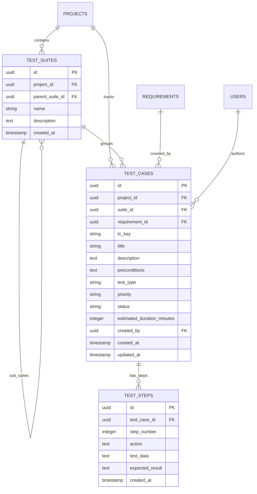
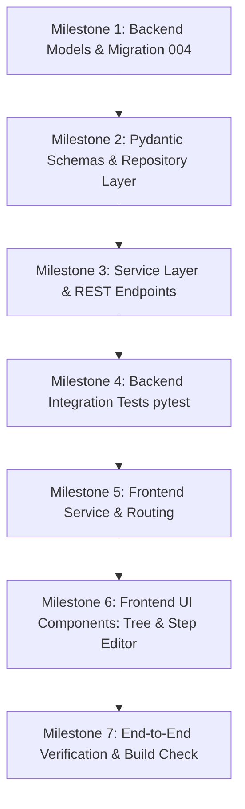

# Phase 5 Implementation Plan: Test Cases & Suites Management
> **Platform:** AI-Powered Software Testing & Bug Intelligence Platform  
> **Status:** PLAN ONLY — Do NOT implement yet.  
> **Architecture Pattern:** Repository → Service → Endpoint → Pydantic Schema (Backend) & Standalone Components → Services → Reactive State (Frontend)  
> **Target Release:** Phase 5 of 11  

---

## 1. Overview & Objectives

In software testing, once software specifications exist (Phase 4), QA teams organize tests into a structured **Test Repository**. Phase 5 builds the **Test Cases & Suites Management System**, enabling engineering and QA teams to:

1. **Organize Tests in Hierarchical Suites**: Group test cases by modules, features, or folders (e.g., `Authentication`, `Checkout Flow`, `Payment Gateway`).
2. **Author Detailed Test Cases**:
   - Sequential project-scoped keys (e.g., `PROJ-TC-01`, `PROJ-TC-02`).
   - Title, narrative description, and preconditions (setup steps).
   - Test Type (`manual`, `automated`, `regression`, `smoke`, `sanity`).
   - Priority (`critical`, `high`, `medium`, `low`) and Status (`draft`, `active`, `deprecated`).
3. **Step-by-Step Test Procedure**:
   - Itemized test steps: Step Number, Action Instruction, Test Data, and Expected Result.
4. **End-to-End Traceability (Phase 4 Linking)**:
   - Link test cases directly to Requirements (`requirement_id` foreign key).
   - Ensures QA coverage tracking across requirements.
5. **Foundation for Next Phases**:
   - Phase 6 (Test Execution Runs) will run these test cases with Pass/Fail/Blocked logging.
   - Phase 9 (AI Engine) will automatically write synthesized test cases into this exact data model.
   - Phase 10 (Playwright) will bind automated scripts to these test cases.

---

## 2. Non-Regression Safeguards (Preserving Existing Functionality)

All existing features from Phases 1, 2, 3, and 4 must remain 100% operational:

| Existing Component | Current Role | Phase 5 Integration (Zero Regression) |
| :--- | :--- | :--- |
| `app/models/user.py` | User authentication & roles | Add relationships for `created_test_cases` (foreign key with `ON DELETE SET NULL`). |
| `app/models/project.py` | Tenant project scoping | Add relationships for `test_suites` and `test_cases` (`ON DELETE CASCADE`). |
| `app/models/requirement.py` | Phase 4 requirements | Add relationship `test_cases` (`ON DELETE SET NULL`) to support requirement coverage. |
| `app/api/dependencies.py` | Tenant security checks | Reuses `get_current_active_user` and `require_project_access` — no breaking changes. |
| `migrations/` | Alembic versions | Add `004_create_test_cases_tables.py` without modifying migrations 001, 002, or 003. |
| `frontend/layout/sidebar` | Shell navigation | Enable `Test Cases` navigation link (set `disabled: false`, remove `Soon` badge). |
| `frontend/app.routes.ts` | Routing configuration | Register `/test-cases` route guarded by `authGuard`. |

---

## 3. Database Schema Design (PostgreSQL)



### PostgreSQL DDL Specifications:

```sql
-- 1. Create Enums for Test Cases
CREATE TYPE test_type_enum AS ENUM ('manual', 'automated', 'regression', 'smoke', 'sanity');
CREATE TYPE test_priority_enum AS ENUM ('critical', 'high', 'medium', 'low');
CREATE TYPE test_status_enum AS ENUM ('draft', 'active', 'deprecated');

-- 2. Test Suites Table (Folder Hierarchy)
CREATE TABLE test_suites (
    id UUID PRIMARY KEY DEFAULT gen_random_uuid(),
    project_id UUID NOT NULL REFERENCES projects(id) ON DELETE CASCADE,
    parent_suite_id UUID REFERENCES test_suites(id) ON DELETE CASCADE,
    name VARCHAR(255) NOT NULL,
    description TEXT,
    created_at TIMESTAMPTZ NOT NULL DEFAULT NOW()
);
CREATE INDEX ix_test_suites_project_id ON test_suites(project_id);
CREATE INDEX ix_test_suites_parent_id ON test_suites(parent_suite_id);

-- 3. Test Cases Table
CREATE TABLE test_cases (
    id UUID PRIMARY KEY DEFAULT gen_random_uuid(),
    project_id UUID NOT NULL REFERENCES projects(id) ON DELETE CASCADE,
    suite_id UUID REFERENCES test_suites(id) ON DELETE SET NULL,
    requirement_id UUID REFERENCES requirements(id) ON DELETE SET NULL,
    tc_key VARCHAR(50) NOT NULL,
    title VARCHAR(255) NOT NULL,
    description TEXT,
    preconditions TEXT,
    test_type test_type_enum NOT NULL DEFAULT 'manual',
    priority test_priority_enum NOT NULL DEFAULT 'medium',
    status test_status_enum NOT NULL DEFAULT 'active',
    estimated_duration_minutes INTEGER DEFAULT 5,
    created_by UUID REFERENCES users(id) ON DELETE SET NULL,
    created_at TIMESTAMPTZ NOT NULL DEFAULT NOW(),
    updated_at TIMESTAMPTZ NOT NULL DEFAULT NOW(),
    CONSTRAINT uq_project_tc_key UNIQUE (project_id, tc_key)
);
CREATE INDEX ix_test_cases_project_id ON test_cases(project_id);
CREATE INDEX ix_test_cases_suite_id ON test_cases(suite_id);
CREATE INDEX ix_test_cases_req_id ON test_cases(requirement_id);
CREATE INDEX ix_test_cases_priority ON test_cases(priority);
CREATE INDEX ix_test_cases_status ON test_cases(status);

-- 4. Test Steps Table
CREATE TABLE test_steps (
    id UUID PRIMARY KEY DEFAULT gen_random_uuid(),
    test_case_id UUID NOT NULL REFERENCES test_cases(id) ON DELETE CASCADE,
    step_number INTEGER NOT NULL,
    action TEXT NOT NULL,
    test_data TEXT,
    expected_result TEXT NOT NULL,
    created_at TIMESTAMPTZ NOT NULL DEFAULT NOW()
);
CREATE INDEX ix_test_steps_test_case_id ON test_steps(test_case_id);
```

---

## 4. Backend Implementation Plan (FastAPI)

### Step 5.1: Database Models & Migration
- **File**: `backend/app/models/test_case.py`
  - Models: `TestSuite`, `TestCase`, `TestStep`.
  - Enums: `TestType`, `TestPriority`, `TestStatus`.
- **File**: `backend/app/models/__init__.py`: Export new models and enums.
- **File**: `backend/app/models/project.py`: Add relationships for `test_suites` and `test_cases`.
- **File**: `backend/app/models/requirement.py`: Add relationship `test_cases`.
- **Migration**: `backend/migrations/versions/004_create_test_cases_tables.py`.

### Step 5.2: Pydantic Validation Schemas
- **File**: `backend/app/schemas/test_case.py`
  - `TestSuiteCreate`, `TestSuiteUpdate`, `TestSuiteResponse` (includes `case_count`).
  - `TestStepCreate`, `TestStepUpdate`, `TestStepResponse`.
  - `TestCaseCreate` (title, suite_id, requirement_id, preconditions, type, priority, status, steps: List[TestStepCreate]).
  - `TestCaseUpdate` (title, suite_id, requirement_id, preconditions, type, priority, status, steps: Optional[List[TestStepCreate]]).
  - `TestCaseResponse` (with full steps and linked requirement details).
  - `TestCaseListResponse` (items, total, skip, limit).
  - `TestCaseFilterParams` (search, suite_id, requirement_id, test_type, priority, status, pagination).

### Step 5.3: Data Repositories
- **File**: `backend/app/repositories/test_case_repository.py`
  - **Suites**: `list_suites_by_project`, `create_suite`, `update_suite`, `delete_suite`.
  - **Sequential Key Generator**: `get_next_tc_key(project_id, project_key)` -> returns `{PROJECT_KEY}-TC-01`, `{PROJECT_KEY}-TC-02`.
  - **Test Cases**: `get_case_by_id`, `list_cases(project_id, filters)`, `count_cases`, `create_case`, `update_case`, `delete_case`.
  - **Test Steps**: Atomic bulk insert / update for test steps in a single database transaction.

### Step 5.4: Business Service Layer
- **File**: `backend/app/services/test_case_service.py`
  - Multi-tenant verification: validates project belongs to active organization.
  - Requirement validation: ensures `requirement_id` (if passed) belongs to the same project.
  - Test suite validation: ensures `suite_id` belongs to the same project.
  - Orchestrates creation, update, deletion, and step indexing.

### Step 5.5: API Endpoints
- **File**: `backend/app/api/v1/endpoints/test_cases.py`
  - `GET /projects/{project_id}/suites`: List all test suites for the project.
  - `POST /projects/{project_id}/suites`: Create a test suite folder.
  - `PUT /projects/{project_id}/suites/{suite_id}`: Update suite name/description.
  - `DELETE /projects/{project_id}/suites/{suite_id}`: Delete suite.
  - `GET /projects/{project_id}/test-cases`: List test cases with filters (search, suite, req, type, priority).
  - `POST /projects/{project_id}/test-cases`: Create test case with step-by-step instructions.
  - `GET /projects/{project_id}/test-cases/{id}`: Detailed test case with steps.
  - `PUT /projects/{project_id}/test-cases/{id}`: Update test case & steps.
  - `DELETE /projects/{project_id}/test-cases/{id}`: Delete test case.
- Register endpoints in `backend/app/api/v1/router.py`.

---

## 5. Frontend Implementation Plan (Angular 17 Standalone)

### Step 5.6: Models & HTTP Service
- **File**: `frontend/src/app/core/models/test-case.model.ts`
  - TypeScript interfaces: `TestSuite`, `TestCase`, `TestStep`, `TestCaseListResponse`, `TestCaseFilters`.
- **File**: `frontend/src/app/core/services/test-case.service.ts`
  - Methods: `getSuites()`, `createSuite()`, `updateSuite()`, `deleteSuite()`.
  - Methods: `getTestCases()`, `getTestCase()`, `createTestCase()`, `updateTestCase()`, `deleteTestCase()`.

### Step 5.7: Routing & Navigation Integration
- **File**: `frontend/src/app/layout/sidebar/sidebar.component.ts`
  - Enable `Test Cases` navigation link (set `disabled: false`, remove `Soon` badge).
- **File**: `frontend/src/app/app.routes.ts`
  - Register route:
    ```typescript
    {
      path: 'test-cases',
      loadComponent: () =>
        import('./features/test-cases/test-cases.component').then(
          (m) => m.TestCasesComponent
        ),
    }
    ```

### Step 5.8: Feature UI Components (`src/app/features/test-cases/`)
1. **`TestCasesComponent` (Split Layout / Main Repository)**:
   - **Left Sidebar**: Suite tree / folder list (`All Test Cases`, `Authentication`, `Checkout`, `+ New Suite`).
   - **Top Toolbar**: Active project selector, Search input, Priority filter, Type filter, `+ New Test Case` button.
   - **Main Table**: Key badge (`ECOM-TC-01`), Title, Linked Requirement pill, Type chip, Priority badge, Steps count, Status, Actions.
   - **Empty States**: Clear onboarding states for projects with 0 suites or 0 test cases.
2. **`SuiteDialogComponent`**:
   - Modal for creating or editing test suite folders.
3. **`TestCaseDialogComponent`**:
   - Comprehensive test case authoring modal:
     - Title, Suite selector, Requirement linker dropdown (pulls from Phase 4 requirements).
     - Test Type, Priority, Status, Estimated Duration, Preconditions text area.
     - **Dynamic Step Table**: Step Number, Action input, Test Data input, Expected Result input, "+ Add Step", and remove step buttons.
4. **`TestCaseDetailComponent`**:
   - Slide-over or inspection drawer displaying:
     - Header: Key, Title, Badges (Type, Priority, Status).
     - Traceability banner: Linked requirement link (`REQ-01`).
     - Preconditions panel.
     - Step-by-step instruction table with Action, Test Data, and Expected Result.
     - Action buttons: "Edit", "Delete", "Close".

---

## 6. Milestone Execution Schedule



| Milestone | Deliverables | Verification |
| :---: | :--- | :--- |
| **Milestone 1** | `test_case.py` model, relationships in `project.py` & `requirement.py`, migration `004`. | Migration executes cleanly on PostgreSQL. |
| **Milestone 2** | `app/schemas/test_case.py` & `app/repositories/test_case_repository.py`. | Key generator tests (`PROJ-TC-01`). |
| **Milestone 3** | `app/services/test_case_service.py` & `app/api/v1/endpoints/test_cases.py`. | Endpoints mounted in `router.py`. |
| **Milestone 4** | `tests/test_test_cases.py` test suite. | 100% pass rate across all 32+ tests (Phase 3 + 4 + 5). |
| **Milestone 5** | `test-case.service.ts`, `app.routes.ts`, and `sidebar.component.ts`. | Route `/test-cases` active. |
| **Milestone 6** | `TestCasesComponent`, `SuiteDialogComponent`, `TestCaseDialogComponent`, `TestCaseDetailComponent`. | Step-by-step editor and suite navigation work smoothly. |
| **Milestone 7** | Full Angular compilation check (`ng build`). | 0 TypeScript errors, zero regressions in Auth/Orgs/Projects/Requirements. |

---

## 7. Verification & Non-Regression Checklist

- [ ] **Existing Suites Passing**:
  - `pytest tests/test_organizations.py` (8 tests)
  - `pytest tests/test_projects.py` (8 tests)
  - `pytest tests/test_requirements.py` (8 tests)
- [ ] **New Phase 5 Backend Tests (`tests/test_test_cases.py`)**:
  - [ ] Test Suite creation and parent-child nesting.
  - [ ] Test Case creation with multi-step procedure (Action, Data, Expected Result).
  - [ ] Sequential key generation (`ECOM-TC-01`, `ECOM-TC-02`).
  - [ ] Link Test Case to Phase 4 Requirement and verify traceability.
  - [ ] Tenant isolation: Org B user cannot view or mutate Org A test cases.
  - [ ] Step reordering and atomic step updates.
- [ ] **Frontend Verification**:
  - [ ] Run `ng build` to guarantee zero compilation errors.
  - [ ] Verify test suite folder tree navigation.
  - [ ] Verify dynamic step row addition and deletion in the test case dialog.
  - [ ] Verify requirement picker dropdown displays project requirements.
